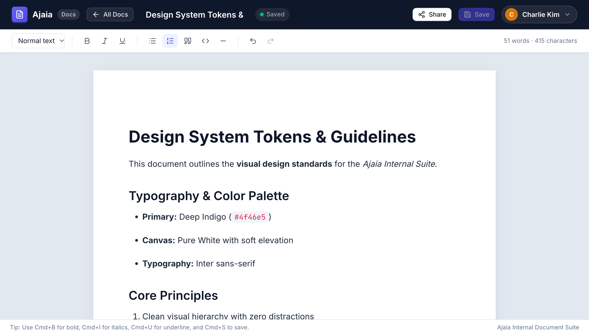
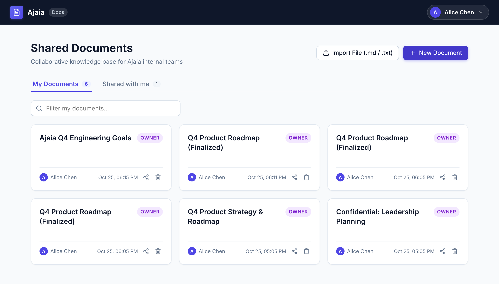

# Ajaia Docs — Collaborative Document Editor

> A lightweight, full-stack collaborative document editor built for **Ajaia** internal teams to move faster on shared work.



---

## 🌟 Highlights & Capabilities

- **Rich-Text Document Authoring**: Full TipTap (ProseMirror core) editor supporting Headings (H1, H2, H3), Bold (`Cmd+B`), Italic (`Cmd+I`), Underline (`Cmd+U`), Bulleted Lists, Numbered Lists, Blockquotes, and Code blocks.
- **Center-Aligned Page Canvas**: Google Docs-inspired paper layout with realistic elevation, page margins, and live word/character counters.
- **Auto-Save & Real-time Status**: Debounced auto-save with instant visual states (`Saved to cloud`, `Saving...`, `Unsaved changes`, `Save failed`).
- **Strict Role-Based Access Control**:
  - Enforced at both the SQLite database and Express API level.
  - **Editor**: Can read, rename, edit content, and auto-save.
  - **Viewer**: Read-only mode with editor canvas locked (`editable: false`) and formatting toolbar disabled.
  - **403 Forbidden**: Unshared users cannot view or edit private documents.
- **1-Click User Switcher**: Easily switch between seeded team personas (Alice, Bob, Charlie) from the top navigation bar to demo access control in seconds.
- **Document Import Workflow**: Import `.md` or `.txt` files directly into newly formatted editable documents with markdown syntax parsed to semantic HTML.
- **Zero-Dependency Persistence**: Embedded SQLite (`better-sqlite3`) database stored locally at `./data/ajaia_docs.db`. Survives server restarts and browser reloads without external cloud databases.

---

## 📸 Screenshots

| Document Editor View | Document Dashboard |
| :---: | :---: |
|  |  |

---

## 📋 Prerequisites

- **Node.js**: v18.0.0 or higher (v20+ or v24 recommended)
- **npm**: v9.0.0 or higher
- **Operating System**: macOS, Linux, or Windows

---

## 🚀 Quick Start (Local Setup)

### 1. Clone & Install Dependencies

From the repository root:

```bash
# Install root and backend dependencies
npm install

# Install client dependencies
npm --prefix client install
```

### 2. Seed Database (Optional — Auto-seeds on first launch!)

The server automatically initializes `./data/ajaia_docs.db` and populates seed data on first boot. If you want to manually seed or reset:

```bash
npm run seed
```

### 3. Run Automated Tests

Run the full end-to-end integration test suite (15 tests covering CRUD, permission enforcement, 403 access denial, and file upload validation):

```bash
npm test
```

### 4. Build & Start the Application

You can run the app in either **Production Mode** (single server) or **Development Mode**:

#### Option A: Production Mode (Single Command — Recommended for Reviewers)
Builds the Vite frontend and starts the Express server serving both API and UI on port `4000`:

```bash
npm run build
npm start
```

Open your browser to: **[http://localhost:4000](http://localhost:4000)**

#### Option B: Development Mode (Concurrent Server + Hot Reloading)
Runs the backend API on port `4000` and Vite dev server with proxy on port `5173`:

```bash
npm run dev
```

Open your browser to: **[http://localhost:5173](http://localhost:5173)**

---

## 👥 Seeded Reviewer Personas

The application includes 3 pre-seeded personas. You can switch between them at any time via the **User Switcher pill** in the top navigation bar:

| Persona | Role | Email | Seeded Access |
| :--- | :--- | :--- | :--- |
| **Alice Chen** (`usr_alice`) | **Product Lead** | `alice@ajaia.internal` | Owns *"Q4 Product Strategy"* and *"Confidential: Leadership Planning"* |
| **Bob Martinez** (`usr_bob`) | **Staff Engineer** | `bob@ajaia.internal` | Owns *"Engineering Architecture"* and has Editor access to Alice's strategy doc |
| **Charlie Kim** (`usr_charlie`) | **Growth Designer** | `charlie@ajaia.internal` | **Unshared Persona**: Used to demonstrate **403 Access Denied** enforcement |

---

## 📤 Supported File Uploads & Limits

Per Section 2.2 of the specification, Ajaia implements **File Upload to New Editable Document**:

- **Supported Formats**: Markdown (`.md`, `.markdown`) and Plain Text (`.txt`).
- **Maximum File Size**: **2 MB** (2,097,152 bytes).
- **Validation & Error Handling**:
  - Unsupported file extensions (e.g. `.pdf`, `.png`, `.docx`) are rejected with a clear user alert.
  - Files exceeding 2 MB are rejected with an explicit size error message.
  - Empty files are rejected.
- **Parsing Behavior**:
  - Markdown headings (`#`, `##`), bolding (`**bold**`), italics (`*italic*`), lists, and blockquotes are converted into structured rich HTML.
  - Extracted document title is populated from the first H1 tag or the filename.
  - Created document is immediately saved to SQLite and opened in the editor.

---

## 🧪 How to Demo the Acceptance Checklist

Follow this simple 4-minute demo walkthrough to verify all core capabilities:

### Step 1: Create, Edit & Save Rich Text (as Alice)
1. Open [http://localhost:4000](http://localhost:4000). Ensure the active user in the top right is **Alice Chen**.
2. Click **`+ New Document`**.
3. In the header, click the title and rename it to *"Ajaia Q4 Engineering Goals"*.
4. In the editor canvas, use the formatting toolbar to add:
   - A **Heading 1** or **Heading 2**
   - **Bold**, *Italic*, and <u>Underline</u> text
   - A **Bulleted List** and a **Numbered List**
5. Notice the status indicator shows **"Saved"** (or click the manual **Save** button).
6. Press `Cmd+R` / `F5` to refresh the browser — **all formatting, title, and content remain intact without data loss**.

### Step 2: Share with Bob as Editor
1. In the top right, click **"Share"**.
2. In the modal, select **Bob Martinez (Staff Engineer)** and set permission to **Editor**.
3. Click **"Add"** — Bob is now added with an "Editor" badge.
4. Click **"Done"**.

### Step 3: Verify Shared Access (as Bob)
1. In the top navigation bar, click the user switcher and select **Bob Martinez**.
2. Click **"All Docs"** to return to the dashboard.
3. Click the **"Shared with me"** tab — see *"Ajaia Q4 Engineering Goals"* listed with an **EDITOR** badge and Alice's avatar as owner.
4. Open the document as Bob — verify all formatting is intact. Bob can edit and save changes collaboratively.

### Step 4: Verify 403 Forbidden Access Enforcement (as Charlie)
1. Switch active user to **Charlie Kim** (the unshared outsider).
2. Notice Charlie's dashboard shows **0 shared documents** (empty state). Alice's private documents are hidden.
3. Try navigating directly to Alice's document URL hash (e.g., `#/doc/doc_prod_strat` or `#/doc/doc_confidential`).
4. The backend and frontend strictly deny access, rendering the clean **"403: Access Denied"** screen with an explanation.

### Step 5: Test File Upload / Markdown Import
1. In the dashboard, click **"Import File (.md / .txt)"**.
2. Select the included test file `sample_doc.md` (or drag & drop any `.md` file).
3. The file is uploaded, parsed into rich HTML headings and lists, and opens immediately in the editor.
4. Try uploading an unsupported file (`.pdf` or `.png`) or file > 2MB to verify friendly error messaging.

---

## 🚆 Deploying to Railway (Zero-Config)

This application is fully pre-configured for **[Railway](https://railway.com)** with [railway.json](file:///Users/umer/task/railway.json):

### Method 1: Deploy from GitHub (Recommended)
1. Push this repository to your GitHub account:
   ```bash
   git remote add origin https://github.com/YOUR_USERNAME/ajaia-docs.git
   git branch -M main
   git push -u origin main
   ```
2. Go to **[Railway.com](https://railway.com)** and click **"New Project"**.
3. Choose **"Deploy from GitHub repo"** and select this repository.
4. Railway will automatically:
   - Detect `railway.json` with the Nixpacks builder.
   - Run `npm install && npm run build` (installing client deps and building the bundle).
   - Launch `npm start` on `0.0.0.0` with Railway's assigned `$PORT`.
   - Monitor health at `/api/health`.
5. In your Railway service dashboard, click **Settings > Networking** and click **"Generate Domain"** to get your public URL (e.g., `https://ajaia-docs-production.up.railway.app`).
6. *(Optional - Data Persistence)*: If you want SQLite documents to persist across Railway redeploys, click **+ New > Volume** and mount path `/app/data`.

### Method 2: Deploy using Railway CLI
```bash
# 1. Install Railway CLI
npm install -g @railway/cli

# 2. Login & Link
railway login
railway init

# 3. Deploy
railway up
```

---

## 🌐 Alternative Free Deployments (Render.com)

1. Sign in to [Render.com](https://render.com) and click **New > Web Service**.
2. Connect your GitHub repository.
3. Settings:
   - **Build Command**: `npm install && npm run build`
   - **Start Command**: `npm start`
4. Click **Deploy Web Service**.

---

## 📂 Project Structure

```
/
├── client/                     # Vite + React Frontend
│   ├── src/
│   │   ├── components/
│   │   │   ├── Navbar.jsx         # Header, rename input, save status, user switcher
│   │   │   ├── DocumentList.jsx   # Owned vs Shared tabs, search filter, cards
│   │   │   ├── DocumentEditor.jsx # TipTap rich-text canvas & toolbar
│   │   │   ├── ShareModal.jsx     # Collaborator management & roles
│   │   │   ├── UploadModal.jsx    # File drag-and-drop & validation
│   │   │   ├── UserSwitcher.jsx   # 1-click persona switching
│   │   │   └── Toast.jsx          # Live alert notifications
│   │   ├── api.js                 # HTTP client with x-user-id header
│   │   ├── App.jsx                # Main controller & routing
│   │   └── index.css              # Ajaia design tokens & styles
│   ├── index.html
│   └── vite.config.js
├── server/                     # Node.js + Express Backend
│   ├── src/
│   │   ├── db.js                  # SQLite database, WAL mode & auto-seed
│   │   ├── auth.js                # Auth middleware (x-user-id header validation)
│   │   ├── app.js                 # Express app & static asset fallback
│   │   ├── index.js               # Server entrypoint
│   │   └── routes/
│   │       ├── documents.js       # CRUD, permissions, shares & upload
│   │       └── users.js           # Team member directory
│   └── tests/
│       └── documents.test.mjs     # 15 Vitest automated integration tests
├── data/
│   └── ajaia_docs.db              # Persistent SQLite database file
├── ARCHITECTURE.md             # 1-page architecture decision record
├── AI_WORKFLOW.md              # AI tools, verification, and rejected outputs
├── SUBMISSION.md               # Honest capability audit & future roadmap
└── README.md                   # Setup, demo instructions & documentation
```

---

## 📄 License
ISC © Ajaia Internal Productivity Tools
